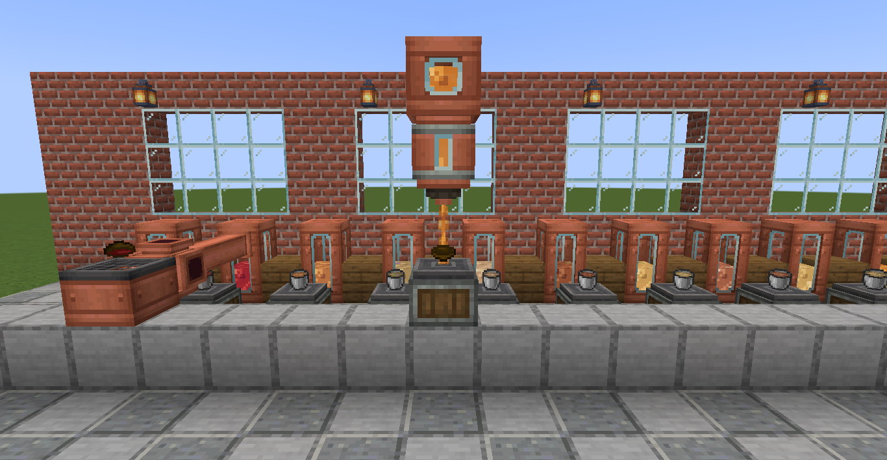

# Create: All the Soup as You Go

Store soup in Create tanks, move it through pipes, and serve it back into bowls.

[Download on Modrinth](https://modrinth.com/mod/create-all-the-soup-as-you-go) ·
[Report an issue](https://github.com/enderliker/create-all-the-soup-as-you-go/issues)

Place a bowl of soup on an **Item Drain** to collect **250 mB** of its fluid and get
the empty bowl back. A **Spout** uses the same amount to fill a bowl again. Each soup
has its own animated fluid texture and bucket. One bucket holds four bowls.

Suspicious stew keeps its effects in bowls, buckets, pipes and tanks. Different
effect combinations cannot mix in one tank. Pouring it into the world loses those
effects, so keep it in containers.

## Supported soups

Minecraft: mushroom stew, beetroot soup, rabbit stew, and suspicious stew.

With Farmer's Delight installed: beef stew, chicken soup, vegetable soup, fish stew,
pumpkin soup, baked cod stew, noodle soup, onion soup, and bone broth. Only dishes
available in your installed version have buckets in creative.

Buckets are available in **Tools & Utilities** and the creative search tab. Item,
fluid, and fluid-block names are translated into English and Spanish (Spain).
The fluids use standard NeoForge capabilities and names for tank displays and
block information overlays. The development setup includes Jade.

## Requirements

- Minecraft 1.21.1
- NeoForge 21.1.251
- Create 6.0.10 for NeoForge
- Java 21
- Farmer's Delight is optional; the machine tests use version 1.3.4.

## Build

Run `./gradlew build` with Java 21. The distributable is
`build/libs/create-all-the-soup-as-you-go-1.1.0.jar`.

## Automated in-game verification and screenshots

`bash tools/run_showcase.sh` opens a dedicated flat world, constructs a kitchen
and separate test rigs for every available soup, runs the Item Drain and Spout,
and checks their outputs. It also verifies that all buckets appear in creative search.

The runner watches the machines' processing state and calls Minecraft's native
screenshot API after rendering with the HUD hidden. It saves images in
`run/screenshots/` and a report in `run/showcase-report.txt`, then closes the game.
Add Farmer's Delight and Jade to `run/mods/` for the full integration run.

The runner's source lives in `src/showcase/java`. It is enabled only with
`-Pshowcase`, and its classes are excluded from the release jar.

Fluid artwork can be regenerated with `python tools/generate_soup_textures.py`.
The supplied blue background and Minecraft's bowl icon form the mod logo.

## Project identity

The Gradle project and jar are named `create-all-the-soup-as-you-go`; the registry
namespace is `allthesoupasyougo`. This replaces the earlier development namespace
`stewtank`, so those old development jars should be removed before installing it.

This is an independent addon for Create. Minecraft belongs to Mojang and Microsoft.
